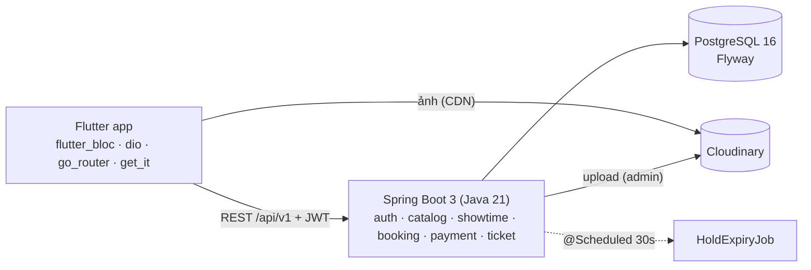

# CineBook

App đặt vé xem phim end-to-end: **Flutter** (BLoC, Clean Architecture) + **Spring Boot 3 / Java 21** + **PostgreSQL 16**. Có giữ ghế 10 phút chống bán trùng ở tầng DB, JWT kèm refresh token xoay vòng, thanh toán giả lập idempotent và vé QR ký HMAC.

[](../../actions/workflows/mobile.yml)
[](../../actions/workflows/backend.yml)

> Thiết kế đầy đủ: [docs/CineBook – Tài liệu phân tích & thiết kế.pdf](docs/). APK, link API demo và GIF demo sẽ bổ sung khi deploy.

## Kiến trúc

Modular monolith: 1 app Flutter, 1 backend Spring Boot, 1 PostgreSQL, ảnh trên Cloudinary.



**Chống bán trùng ghế bằng DB:** giữ ghế = insert `booking_seats` trong một transaction. Partial unique index `(showtime_id, seat_id) WHERE is_active` khiến request thứ hai thất bại, API trả `409 SEAT_TAKEN`. Đơn hết hạn hoặc bị huỷ thì set `is_active = false` để nhả ghế. Suất chiếu trùng giờ trong cùng phòng bị chặn bằng ràng buộc `EXCLUDE USING gist`.

| Lớp | Công nghệ |
|---|---|
| Mobile | Flutter 3, flutter_bloc, dio (tự refresh khi 401), go_router (redirect khi chưa đăng nhập), get_it, freezed + json_serializable, flutter_secure_storage, cached_network_image, qr_flutter, intl |
| Backend | Spring Boot 3.5, Java 21, Gradle, Spring Security (JWT HS256 stateless, `@PreAuthorize`), Spring Data JPA, springdoc OpenAPI, lỗi theo ProblemDetail (RFC 9457) |
| DB | PostgreSQL 16 + Flyway (`unaccent`, `pg_trgm`, `btree_gist`); 2 role `cinebook_migrator` / `cinebook_app` |
| File | Cloudinary (poster, banner, combo) |
| Test / CI | JUnit 5 + Testcontainers, bloc_test, GitHub Actions (build APK release) |
| Deploy | Docker → Render, Postgres trên Neon/Supabase |

## Cấu trúc repo

```
cinebook/
├── .github/workflows/   # mobile.yml, backend.yml, db-backup.yml
├── docs/                # tài liệu thiết kế, screenshots/, postman/
├── mobile/              # Flutter: lib/{app,core,features/<feature>/{data,domain,presentation}}
│                        # features: auth, movies, showtimes, seat_map, checkout, tickets
└── backend/             # Spring Boot: com.cinebook.{auth,catalog,showtime,booking,payment,ticket,
                         #   media,security,config,common}; db/migration V1..V6 + db/seed R__
```

## Chạy backend

Cần JDK 21 và Docker (hoặc PostgreSQL 16 cài sẵn trên máy).

```bash
cd backend
cp .env.example .env    # điền JWT_SECRET, QR_HMAC_KEY: openssl rand -base64 48
docker compose up -d    # PostgreSQL 16 + 2 role + extension
./gradlew bootRun       # profile dev: chạy migration và nạp seed demo
```

- API: `http://localhost:8080/api/v1`. Swagger UI (tạm làm trang admin cho MVP): `http://localhost:8080/api/v1/swagger-ui.html`
- Postman: [`docs/postman/cinebook.postman_collection.json`](docs/postman/cinebook.postman_collection.json)
- Tài khoản demo (mật khẩu `Demo@1234`): `demo@cinebook.dev`, `demo2@cinebook.dev` (khách), `admin@cinebook.dev`, `staff@cinebook.dev`
- Test: `./gradlew test`. Integration test chạy PostgreSQL thật qua Testcontainers và tự bỏ qua khi máy không có Docker.

Profile: `dev` (local, có seed), `demo` (Render, có seed), `prod` (không seed). Flyway chạy bằng role `cinebook_migrator`, app chạy bằng `cinebook_app` (chỉ có quyền DML).

> Gói free của Render cho server "ngủ" khi không có truy cập, nên request đầu tiên có thể mất 30–60 giây.

## Chạy mobile

Cần Flutter 3.32+ (Dart 3.8+).

```bash
cd mobile
./tool/fetch_fonts.sh                     # tải font Be Vietnam Pro vào assets/fonts (chạy 1 lần)
flutter pub get
dart run build_runner build -d            # sinh code freezed / json_serializable
flutter run --dart-define=API_BASE_URL=http://10.0.2.2:8080/api/v1
```

`10.0.2.2` là máy host khi chạy trên Android emulator; trên iOS simulator dùng `http://localhost:8080/api/v1`.

Test: `flutter test` và `flutter test integration_test`.
